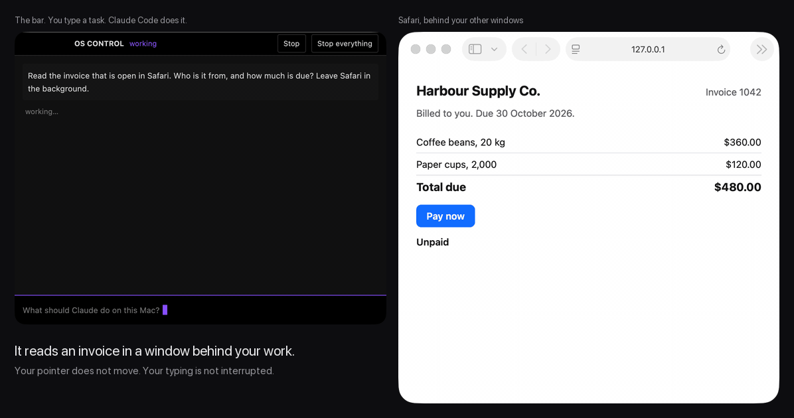
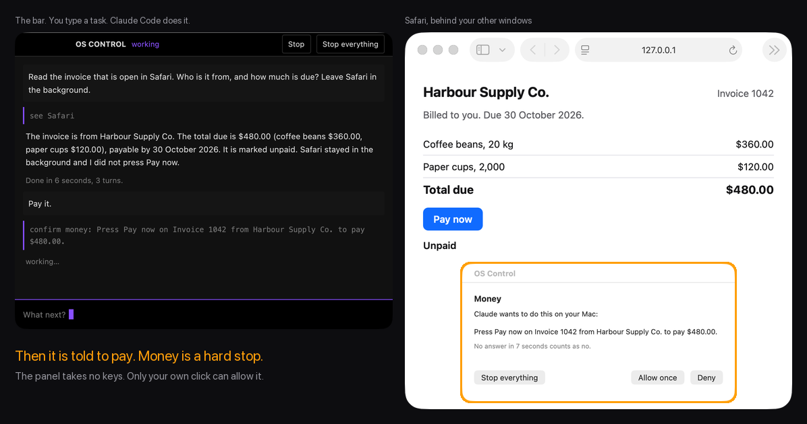

# OS Control

[](https://github.com/Veso-AI-Open-Source/os-control/actions/workflows/ci.yml)

**Eyes and hands for Claude Code on your Mac.**

> **New in 0.2.0:** acts check their result, and the compiler makes every input pass the gate. See the [changelog](CHANGELOG.md).



Claude Code already has your shell. It cannot see your screen or touch an app. OS Control adds that. Any Claude Code session can read every window, press every button, and type into every field.

Four kinds of act always stop and ask you first: money, sending as you, passwords, and destructive changes. The agent cannot give its own yes. The panel takes no keys, and it refuses any click that did not come from your own mouse.

> This hands an AI model the controls of your Mac. Read [Limits](#limits) before you turn it on.

## What makes it different

1. **It reads the tree, not the pixels.** The tools walk the accessibility tree, the same one a screen reader uses. Each control arrives with its role, its label, and its real frame. The model picks a thing. It never invents a position.
2. **It works behind you.** A press goes straight to the control. The app does not come to the front and your pointer does not move. You keep working while it works.
3. **The hard stops live in code.** The model does not decide whether a gate applies. The code does, from facts it reads off the screen: the app, the web address, the label about to be clicked, and the key about to be pressed. Every input needs a ticket that only the gate can issue, so code that skips the gate does not compile.
4. **Only you can say yes.** The gate panel never takes the keyboard, so no stray key can answer it. Allow needs a real click. A click posted by software is refused. So is a press sent through the accessibility API. Both are tested.
5. **One switch stops everything.** Push the pointer into the top-left corner, run `osctl stop`, or press Stop everything. Every tool in every session then refuses until you resume.
6. **Acts check their result.** Raising an app, hiding it, and focusing a field are confirmed before the tool says they worked. When macOS ignores one way, the tool tries the next. A click says whether the window changed, and "could not tell" is never reported as "no".
7. **Everything is on the record.** Each tool call and each gate answer is one line in a local log.

## Measured (MacBook Air M5, 24 GB, macOS 26.5)

| What | Result |
|---|---|
| Read every control in a Chrome window, 241 controls | 0.35 s |
| Screenshot of one display, scaled for the model | 0.43 s |
| Claude Code works out 123 × 45 in Calculator, in the background | 12 turns, 11 s |
| A real job in a web portal: find a setting, stage it, stop before Save | 38 calls, 3.2 s inside the tools |
| The demo above: read the invoice, then refuse to pay | 6 s, then 14 s |

The time inside the tools is small. The model's own thinking is the slow part.

**0.2.0 against 0.1.0** (Apple silicon, macOS 27). Both builds ran as MCP servers through the same scenarios, three trials each, in alternating order. Independent checks read the result: System Events, TextEdit's scripting, and a read-only `see`.

| What | 0.1.0 | 0.2.0 |
|---|---|---|
| Bring an app to the front: worked, reported truthfully, median | 8 of 12, 4 of 12, 1.6 s | 12 of 12, 12 of 12, 0.15 s |
| Hide an app: reported truthfully | 0 of 9 | 9 of 9 |
| Tell which app is in front | 0 of 12 | 12 of 12 |
| Type into a field that ignores the accessibility focus (LibreOffice's Name Box) | 0 of 3 | 3 of 3 |
| Type into a field that already holds text | 0 of 3 | 3 of 3 |
| Flag a click that changes nothing | 0 of 3 | 3 of 3 |

Checking costs about 90 ms on a click that changes something, and up to 0.6 s before a tool reports that nothing changed.

## Quick start

You need macOS, Rust, the Xcode command line tools, and Claude Code. `~/.local/bin` must be on your `PATH`.

```
git clone https://github.com/Veso-AI-Open-Source/os-control
cd os-control
make install     # builds osctl, the gate panel, and the bar into ~/.local/bin (a few minutes the first time)
make register    # gives the tools to every Claude Code session of this user
osctl grant      # asks macOS for Accessibility and Screen Recording
```

macOS gives the grants to the app that starts the process. For most people that is the terminal.

Start a new Claude Code session and ask in plain words:

```
Open System Settings and tell me which apps can record the screen.
```

Or open the bar, type a task, and press Return:

```
os-bar &
```

Claude Code asks before each tool call unless you allow the tools. To allow them all, add `"mcp__os"` to `permissions.allow` in `~/.claude/settings.json`. The hard stops still apply.

## The tools

| Tool | What it does |
|---|---|
| `see` | Lists the controls of one app with ids, and returns a screenshot. Works on apps in the background. |
| `click` | Presses a control by id, label, or role with no pointer movement. Falls back to the real pointer when it must. Says whether the window changed. |
| `type` | Types into the focused field, or focuses a field first and checks that the focus landed. Says when the field already held text, and reads it back. It can also set a field's text with no key presses. |
| `key` | Presses keys such as `cmd+s`. |
| `scroll` | Scrolls by lines. Passes the gate like every other act. |
| `drag` | Presses on one thing and releases on another. |
| `app` | Lists, opens, raises, hides, and quits apps. Raise and hide check the result, and try the next way when macOS ignores one. |
| `confirm` | Asks you for a yes before a hard stop. |

Keys and typed text go to the app in front. Each of those tools takes an `app` guard and refuses if another app is there. Typing stops part way if the focus moves.

The same tools work from a shell: `osctl call see '{"app":"Safari"}'`. Run `osctl` with no arguments for the full list of commands.

## Hard stops

| Gate | It catches |
|---|---|
| Money | Buttons such as Pay, Buy, Place order, and Transfer. Any click on a bank, broker, or checkout page. |
| Sending as you | Buttons such as Send, Post, Reply, and Submit. Return in a chat app. Cmd+Return anywhere. |
| Passwords and keys | Typing into a password field. Any click in Keychain Access, Passwords, 1Password, or a system password dialog. |
| Destructive changes | Buttons such as Delete, Erase, Reset, and Sign out. A drop on the Trash. Cmd+Delete in Finder. Disk Utility. |

The rules are plain lists in `crates/os-core/src/gate.rs`. Run `osctl policy` to print them. Save an edited copy as `policy.json` in `~/Library/Application Support/OS Control` to change them. A file that does not parse stops every tool, so a typo cannot switch the gates off.

How the panel behaves:

- It never takes the keyboard. It is safe to show while you type elsewhere.
- Allow needs a real click from your mouse or trackpad.
- No answer in two minutes is a no.
- While it shows, the tools refuse all input.

A rule about what an act is, such as a Transfer button, asks every time. A rule about where you are, such as a bank's site, offers a yes for ten minutes.



## Stop

Three ways to stop everything:

1. Push the pointer into the top-left corner of the main display.
2. Run `osctl stop`.
3. Press Stop everything in the bar or on a gate panel.

Resume with `osctl resume` or the bar's Resume button. The bar's Stop button ends one run and leaves the rest alone.

## Records

Every tool call and every gate answer is one line in `~/Library/Application Support/OS Control/audit.jsonl`. Typed text is logged as a count and its first 80 characters. Text typed into a password field is logged as a count only. Screenshots are not kept. `osctl log` prints the last lines.

## Limits

- **The gates are guard rails, not a jail.** A session also has a shell, and your terminal holds the Accessibility grant. A session that set out to cheat could post its own events from the shell, or edit `policy.json`. The gates stop mistakes. They stop instructions hidden in a web page or an email. They do not stop a model that is trying to get round them.
- **The shell has no gates of its own** beyond Claude Code's permission modes.
- **The label rules read English.** An app that draws its own controls, such as a game or some cross-platform apps, has no tree. There the tools fall back to positions, and only the place rules and the model's own `confirm` apply.
- **When you are away, nobody can click Allow.** Gated acts are refused.
- **The grants belong to your terminal.** A bar you open from the Dock would need its own grants and a signed app bundle. That is not built.
- **It has run on Apple silicon only,** on macOS 26.5 and macOS 27. Intel Macs and older systems are untried.
- **Built but not yet tried live:** double click, position clicks on a second display, the corner gesture, and steering a session from a phone.
- **A missing Screen Recording grant is silent.** `see` returns a black screenshot and no window names, without saying why ([#8](https://github.com/Veso-AI-Open-Source/os-control/issues/8)). The control list still works.

## Layout

```
crates/os-core    the tools: tree reader, input, screen, apps, gates, verification, audit log
crates/osctl      the command line and the MCP server
crates/os-bar     the bar, a small native window built with GPUI
helpers/ask.swift the gate panel, one Swift file
tests/            live checks on the real desktop
demo/             the script that recorded the demo above
WORKLOG.md        the work so far, the snags, and the next steps
CHANGELOG.md      what changed in each version
CONTRIBUTING.md   branches, the CI pipeline, and the privacy rules
.github/          CI and the pull request template
```

```
make test                      51 tests. They touch nothing on screen.
make live                      Live checks. Calculator only, in the background.
python3 tests/foreground.py    Real key presses. Takes the focus for two seconds.
make demo                      Records docs/demo.gif.
```

When a control does not show up the way you expect, `osctl call inspect '{"app":"Safari","label":"Pay now"}'` prints everything the accessibility API says about it.

## How it's built

This codebase was written with agentic AI coding, end to end, in one morning. Claude Code wrote the tools, then used them. Its first real job was in a web portal: it found a setting, staged it, checked a recording by downloading and transcribing it, and stopped before Save because it had been asked to find out, not to change.

[WORKLOG.md](WORKLOG.md) records what was built, what broke, how it was checked, and what comes next.

Each claim in this README has a check behind it. The unit tests cover the gate rules, the key parser, and the protocol. The live checks drive real apps. One of them shows the gate panel, sends it a posted click and an accessibility press, and passes only if both are refused.

## Next

Bounded work, each item with a clear test:

1. Say what kind of change followed an act: the page went elsewhere, or a window opened. Clicks already say whether anything changed ([#12](https://github.com/Veso-AI-Open-Source/os-control/issues/12)).
2. Refuse to act on a window that changed since the last look.
3. Read a dropdown's choices without opening it, and pick one in a single call.
4. Name icon-only buttons from their classes.
5. Wait until a page settles, with no fixed sleeps.
6. Capture one window even when it is covered.
7. Decide whether Save on a live web service deserves a fifth gate.
8. A signed app bundle with its own grants.
9. Labels in other languages.

Open bugs and planned work are tracked in [Issues](https://github.com/Veso-AI-Open-Source/os-control/issues).

## Contributing

Read [CONTRIBUTING.md](CONTRIBUTING.md) for the branches, the CI pipeline, and the privacy rules. Pick an item from Next, or bring your own. A change to the gates needs a unit test in `gate.rs`. A change to a tool needs a live check. Say what you ran.

## Credits

[agent.exe](https://github.com/corbt/agent.exe) by Kyle Corbitt showed how little it takes to hand a computer to a model, and how badly that needs brakes. The bar is built with [GPUI](https://www.gpui.rs) from the Zed team. The tools speak the [Model Context Protocol](https://modelcontextprotocol.io).

OS Control is not affiliated with Anthropic. Claude and Claude Code are their trademarks.

Apache-2.0. See NOTICE.
